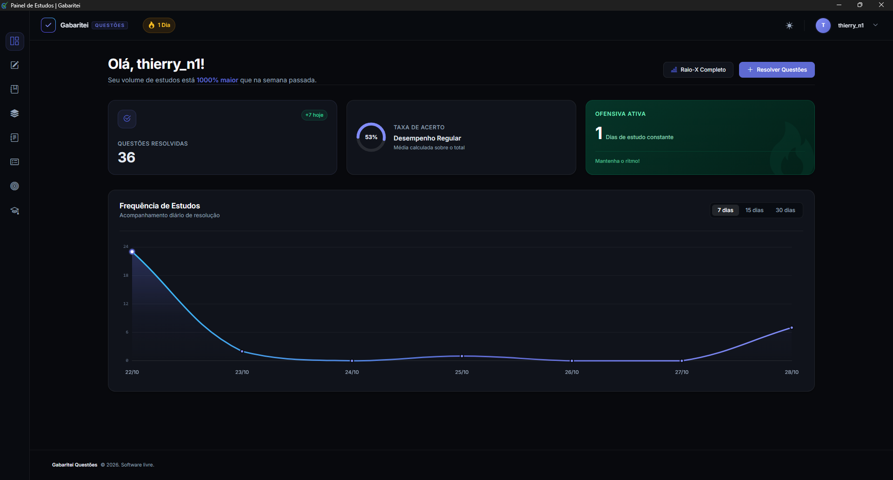

<div align="center">
  

# Gabaritei Questões

**Domine as questões, conquiste a vaga.**

Plataforma de estudos para concursos com inteligência artificial — **questões comentadas, simulados, flashcards, resumos, cadernos e editais**. Software livre e sem paywall: todo aluno cadastrado usa tudo, e o progresso fica na nuvem com a própria conta.

[](./LICENSE)


[Recursos](#recursos) · [Arquitetura](#arquitetura) · [Segurança](#modelo-de-seguranca) · [Instalação](#instalacao) · [Testes](#testes) · [Documentação](#documentacao)


</div>

---

<a id="recursos"></a>
## ✨ Recursos

| | |
|---|---|
| 📝 **Questões comentadas** | Explicação pedagógica gerada por IA para cada questão, além de comentários da comunidade com blocklist local e denúncia para triagem humana |
| 📋 **Simulados** | Monte simulados personalizados e acompanhe o desempenho por matéria |
| 🖨️ **PDF de simulados** | Prévia navegável em A4: no desktop o Electron gera o PDF nativo; no navegador, o aluno usa "Salvar como PDF" via `window.print()` |
| 🧠 **Flashcards** | Revisão com repetição espaçada (SM-2 customizado), sessão com flip, avaliação 0–3 e estados vazio/final |
| 🤖 **IA de estudos (BYOK)** | Explicações, resumos e flashcards gerados pela **sua própria chave de API** (OpenAI, Google Gemini ou Anthropic), configurada em Configurações da conta e guardada só no seu dispositivo (cifrada com DPAPI) — explicações geradas ficam salvas no banco (cache global para todos os alunos) |
| 📑 **Editais** | Trilha de estudo por edital, com progresso por tópico e ciclo de revisão |
| 📚 **Cadernos e filtros** | Coleções de questões salvas e filtros de busca reutilizáveis |
| 📊 **Painel do aluno** | Estatísticas, raio-X por matéria e tópico, curva de esquecimento, calendário de metas e ofensiva (streak no horário de Brasília) |
| ☁️ **Conta na nuvem** | Login com e-mail e senha (Supabase Auth) — o progresso acompanha o aluno em qualquer máquina, com sessão lembrada entre execuções |
| 🌗 **Tema claro/escuro** | Preferência salva na conta |

<a id="arquitetura"></a>
## 🧱 Arquitetura

```text
Electron (janela do app)  ──spawna──▶  Flask (127.0.0.1:5000)  ──HTTPS──▶  Supabase (PostgreSQL)
     desktop/main.js                        app.py + rotas/                   PostgREST + Auth + RLS
```

| Camada | O quê | Onde |
|---|---|---|
| **Shell** | Janela do app — spawna o backend e abre direto na tela de login | `desktop/main.js` |
| **Backend** | Flask com **11 blueprints** — auth, aluno, api, questão, simulado, edital, conta, caderno, filtro, flashcards e resumos | `app.py`, `rotas/` |
| **Banco** | Supabase (PostgreSQL) acessado com a **ANON key pública** + `APP_TOKEN` nas escritas — a segurança vive nas policies RLS no banco | `docs/banco_dados.md` |
| **Página de e-mail** | Página estática no GitHub Pages que recebe o redirect dos e-mails do Auth (confirmação de cadastro e redefinição de senha) | `site/` |

<a id="modelo-de-seguranca"></a>
## 🔐 Modelo de segurança

- **Conteúdo é aberto; escrita é do dono**: questões, matérias e taxonomia são legíveis por qualquer visitante. Os dados de estudo têm `SELECT` liberado pelo desenho atual (exceto as 3 tabelas de progresso de edital, exclusivas do dono), mas `INSERT`/`UPDATE`/`DELETE` exigem o dono (`auth.uid()` vinculado a `usuarios.auth_id`).
- **Escrita em dados do aluno exige dois fatores**: o header `x-app-token` (segredo de app, migration `rls_header_app_aluno`) **e** a identidade do dono no JWT — mesmo que alguém extraia a ANON key **e** o token do binário, não consegue tocar dados de outro aluno. Feedbacks, caches de IA e estatísticas anônimas aceitam INSERT só com o token, por design.
- **A chave `service_role` nunca** faz parte deste app: a gestão de conteúdo roda num painel separado, com 2FA próprio.
- **Perfis legados são adotados no 1º login**: alunos das eras anteriores ao Supabase Auth (web/SaaS e desktop passwordless) têm o perfil re-vinculado à conta Auth pelo próprio RLS, sem duplicação.
- Detalhes completos: [docs/banco_dados.md](docs/banco_dados.md)

<a id="instalacao"></a>
## 🛠️ Instalação (dev)

**Pré-requisitos:** Python 3.15+, Node.js (apenas para o shell Electron) e um projeto Supabase. Os recursos de IA usam a chave do próprio aluno (BYOK — OpenAI, Google Gemini ou Anthropic, configurada pela UI da conta).

```powershell
python -m venv venv
.\venv\Scripts\activate
pip install -r requirements.txt
copy .env.example .env                       # preencha SUPABASE_URL, ANON key, APP_TOKEN e FLASK_SECRET_KEY
copy desktop\token.example.js desktop\token.local.js   # o MESMO APP_TOKEN do .env
python app.py                                # http://127.0.0.1:5000
```

Shell Electron (dev):

```powershell
cd desktop
npm install
npm start          # spawna o Flask do venv e abre a janela
```

Gerar o executável do Windows (backend PyInstaller + instalador NSIS):

```powershell
powershell -ExecutionPolicy Bypass -File desktop\build.ps1
# → desktop\dist\Gabaritei.exe (+ win-unpacked/ portátil)
```

> O PDF de simulados é gerado no **cliente**: o app desktop usa `electronAPI.printToPDF()` (Electron `printToPDF`, A4) e o navegador cai no `window.print()` com "Salvar como PDF". Não há WeasyPrint nem dependência de GTK no fluxo de PDF. O `build.ps1` ainda baixa e copia um runtime GTK legado — etapa herdada da antiga geração server-side, sem uso pelo app em execução.

> A ANON key é **pública por design** (vai embarcada no binário) — a segurança do produto vive nas policies RLS, não no segredo da chave. O `service_role` nunca é usado aqui. Detalhes completos do build: [docs/desktop.md](docs/desktop.md).

<a id="encoding"></a>
## 🔤 Encoding e Compatibilidade

O projeto utiliza **UTF-8 como encoding padrão** (Python 3.15+ adota UTF-8 por padrão, PEP 686):

| Contexto | Encoding | Detalhes |
|---|---|---|
| **Arquivos .py** | UTF-8 | Todos os fontes usam UTF-8 (inclui emojis em logs/mensagens) |
| **Arquivos .html/.css/.js** | UTF-8 | Templates Jinja2 e assets estáticos |
| **Banco de dados (Supabase/PostgreSQL)** | UTF-8 | `utf8` / `utf8mb4` — suporta emojis e acentuação completa |
| **Sessão Flask / Cookies** | UTF-8 | `session.permanent = True` com cookies compatíveis |
| **Console/Logs (Windows)** | UTF-8 | `sys.stdout.reconfigure(encoding='utf-8', errors='backslashreplace')` no `app.py` para emojis no CP1252 |
| **Variáveis de ambiente (.env)** | UTF-8 | Valores com acentos/emojis funcionam corretamente |

> [!IMPORTANT]
> Em Python 3.15, o encoding padrão do sistema é UTF-8 independente da locale. Para compatibilidade com versões anteriores, o código usa `encoding='utf-8'` explicitamente em operações de I/O de arquivos (`open()`, `json.load()`, etc.). O console Windows (CP1252) recebe emojis via `errors='backslashreplace'` para não quebrar a saída.

<a id="testes"></a>
## ✅ Testes

```powershell
.\rodar_testes.bat          # ou: python -m unittest discover -s tests
```

São **139 testes** que não exigem um banco real para passar, cobrindo login e cadastro, re-link de perfis legados, questões e streaks, filtro de status, simulados, flashcards (incluindo rota global, estado vazio e validações da revisão), editais, IA/BYOK, cadernos, resumos, taxonomia pública e honeypots de segurança. Especificação completa em [tests/README.md](tests/README.md).

<a id="documentacao"></a>
## 📚 Documentação

| Documento | O quê |
|---|---|
| [docs/app.md](docs/app.md) | Arquitetura do app Flask |
| [DESIGN.md](DESIGN.md) | Design system, temas e painel do aluno |
| [docs/desktop.md](docs/desktop.md) | Shell Electron (app instalável) |
| [docs/banco_dados.md](docs/banco_dados.md) | Banco, RLS e modelo de segurança |
| [docs/rotas/](docs/rotas/) | Cada blueprint documentado — inclui [painel e estatísticas](docs/rotas/aluno.md) |
| [docs/utils.md](docs/utils.md) · [docs/extensoes.md](docs/extensoes.md) | Utilitários e extensões Flask |
| [site/README.md](site/README.md) | Página pública de confirmação de e-mail (GitHub Pages) |
| [tests/README.md](tests/README.md) | Especificação da suíte de testes |
| [PRODUCT.md](PRODUCT.md) | Fatos confirmados do produto |

<a id="contribuicao"></a>
## 🤝 Contribuição

Issues e pull requests são bem-vindos! Antes de mexer no modelo de dados, leia [docs/banco_dados.md](docs/banco_dados.md) (as policies RLS são o coração da segurança) e rode a suíte de testes — ela não exige banco real nem chaves de API.

<a id="licenca"></a>
## 📄 Licença

Distribuído sob a licença **MIT** — veja [LICENSE](LICENSE) para detalhes.
