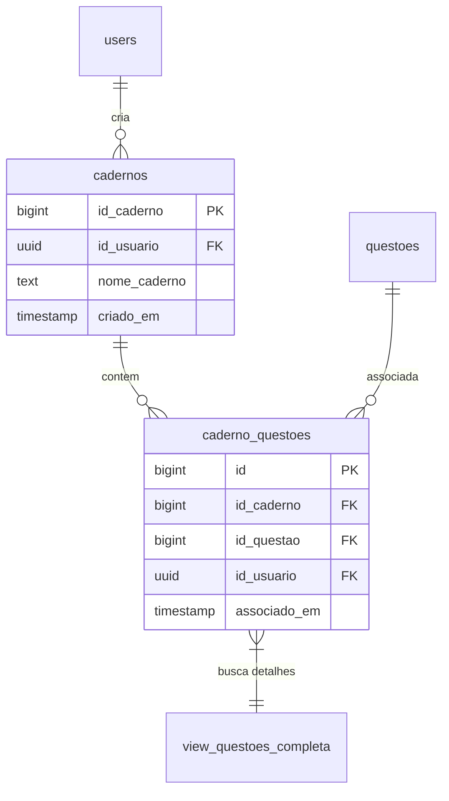
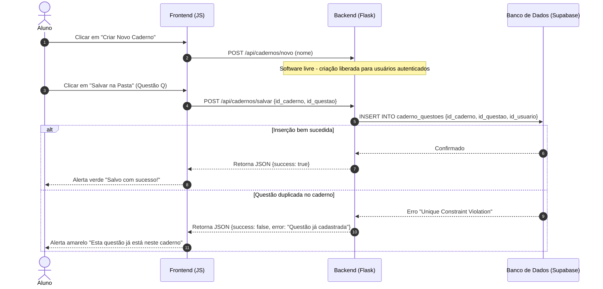

# 📁 Documentação Técnica: `rotas/caderno.py` (Gestão de Cadernos de Questões)

O módulo de **Cadernos de Estudos** oferece uma solução robusta para organização personalizada de conteúdos dentro do Gabaritei. Ele atua como um sistema de pastas virtuais onde os estudantes agrupam questões por afinidade, tema ou estratégia de revisão, contando com análises de acertos e erros contextualizadas por caderno.

---

## 🛠️ Arquitetura de Dados

O ecossistema de cadernos de estudos é sustentado por duas tabelas principais e uma visão consolidada no Supabase:



*   **`cadernos`**: Armazena a estrutura do caderno de forma isolada por usuário.
*   **`caderno_questoes`**: Tabela associativa (junção n-para-n) que mapeia o vínculo atômico entre um caderno e uma questão.
*   **`view_questoes_completa`**: View unificada que consolida textos bases, enunciados, alternativas e taxonomia das questões de modo a evitar múltiplos joins custosos nas rotas de visualização.

---

## 🔄 Fluxo de Trabalho e Ciclo de Vida do Caderno

O diagrama de sequência abaixo descreve a criação e alimentação de um caderno, destacando as travas de segurança:



---

## 🧭 Detalhamento das Rotas e Integrações de API

### 1. Painel e Listagem Física (`/aluno/meus_cadernos`)
*   **Método**: `GET`
*   **Acesso**: `@aluno_required` (Restrito a estudantes autenticados).
*   **Lógica**: Carrega de forma síncrona todos os cadernos cuja propriedade pertence ao estudante ativo (`current_user.id`) e renderiza o template dinâmico `questoes/cadernos.html`.
*   **Robustez**: Em caso de falha de conexão ou timeout com o Supabase, um fallback elegante exibe uma tela limpa informando a instabilidade momentânea sem derrubar a aplicação.

### 2. Painel de Estudos e Desempenho Contextual (`/aluno/caderno/<id_caderno>`)
*   **Método**: `GET`
*   **Acesso**: `@aluno_required`
*   **Lógica**:
    1. Recupera o nome do caderno e a lista dos IDs das questões associadas a ele.
    2. Busca o bloco detalhado das questões diretamente através da `view_questoes_completa` usando filtragem em massa (`.in_("id_questao", ids_questoes)`).
    3. Cruza os IDs com o histórico do estudante (`historico_respostas`) para obter os acertos e erros ocorridos especificamente nessas questões.
*   **Coloração de Desempenho**: As questões resolvidas são renderizadas com badges indicativas:
    *   `Badge Verde (Acerto)`: Se o ID da questão está presente em `ids_acertos`.
    *   `Badge Vermelha (Erro)`: Se o ID da questão está presente em `ids_erros`.

### 3. API assíncrona de CRUD (`/api/cadernos/...`)

Para garantir uma experiência de uso rápida e sem reloads na interface web, as seguintes APIs em formato JSON são implementadas:

*   **`listar_cadernos`** (`GET /api/cadernos`):
    Retorna uma lista contendo todos os cadernos criados pelo usuário. Muito usada em combos suspensos (dropdowns) na tela de resolução de questões globais.
*   **`criar_caderno`** (`POST /api/cadernos/novo`):
    Cria a entidade caderno para o usuário autenticado, sem limites de uso (modelo software livre).
*   **`salvar_na_pasta`** (`POST /api/cadernos/salvar`):
    Vincula uma questão ao caderno. Protege o banco de redundâncias, capturando violações de chaves únicas (`duplicate key`) e convertendo-as em avisos amigáveis para o usuário.
*   **`remover_questao_caderno`** (`POST /api/cadernos/remover_questao`):
    Desfaz a relação na tabela `caderno_questoes` mantendo a integridade da questão e do caderno no sistema.
*   **`excluir_caderno`** (`POST /api/cadernos/excluir/<id_caderno>`):
    Deleta o caderno. O relacionamento em banco garante a remoção em cascata (`ON DELETE CASCADE`) dos vínculos das questões sem gerar órfãos.

---

## 🔐 Blindagem e Padrões de Segurança

> [!IMPORTANT]
> **Defesa Estrita contra IDOR (Insecure Direct Object Reference)**:
> Nenhuma query SQL de alteração ou exclusão confia no ID do usuário vindo da requisição sem passar pela sessão do servidor. Todas as operações atômicas no banco de dados aplicam obrigatoriamente a cláusula de isolamento:
> ```python
> .eq("id_usuario", current_user.id)
> ```
> Isso garante que um estudante malicioso jamais consiga visualizar, criar cadernos no nome de outros alunos, deletar cadernos alheios ou adulterar relacionamentos de terceiros trocando IDs numéricos no payload HTTP.

> [!NOTE]
> **Isenção de Rate Limits (`@limiter.exempt`)**:
> As APIs assíncronas de cadernos são isentas de rate limit agressivos para prevenir que interações rápidas do usuário (ex: adicionar rapidamente várias questões a pastas diferentes ou criar múltiplos cadernos de revisão em sequência) gerem falsos positivos no sistema de segurança, impedindo o fluxo de estudos.
