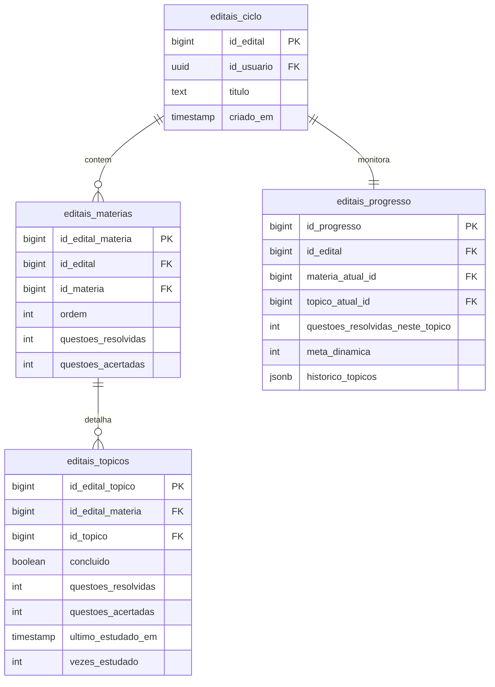
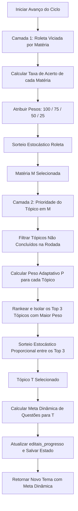
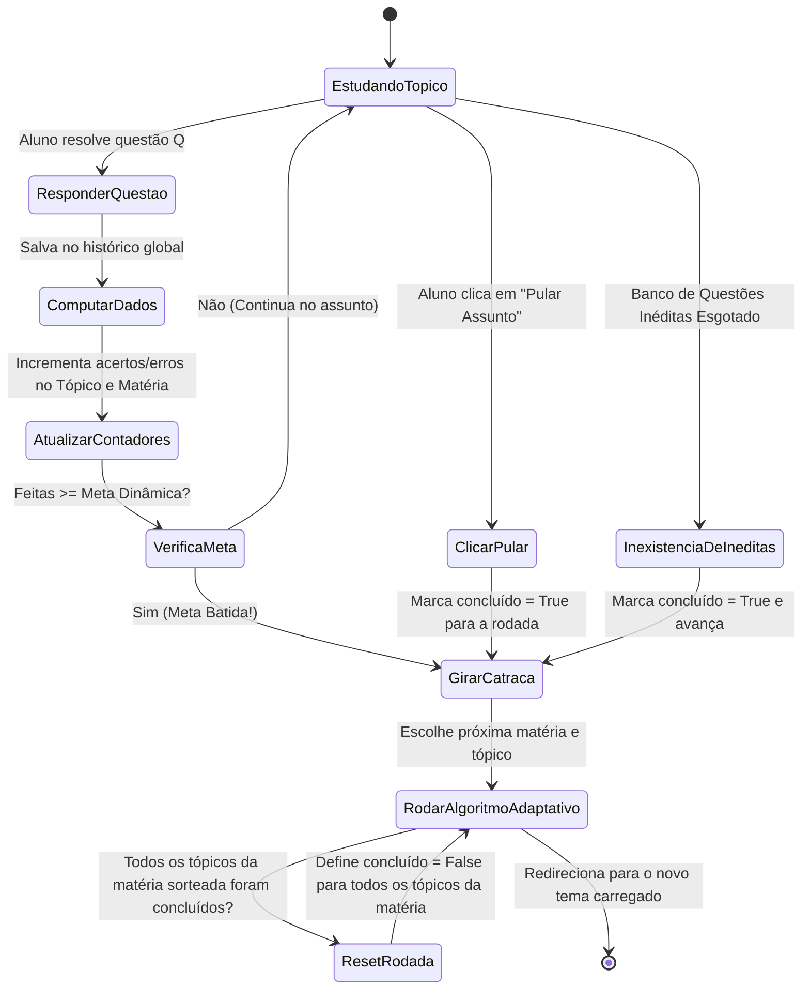

# 📑 Documentação Técnica: `rotas/edital.py` (Editais Verticalizados e Ciclo de Estudos Adaptativo)

O módulo de **Editais Verticalizados** representa o motor pedagógico avançado do Gabaritei. Ele transcende a mera filtragem de questões ao implementar um **Ciclo de Estudos Adaptativo de Duas Camadas** orientado pelo desempenho real do aluno. O sistema opera como um "GPS de estudos dinâmico", direcionando os esforços do estudante aos temas que exigem maior reforço prático, enquanto distribui de forma inteligente as revisões periódicas.

---

## 🛠️ Arquitetura de Dados (4 Camadas de Persistência)

O ciclo de estudos estruturado apoia-se em quatro entidades principais no banco de dados Supabase:



*   **`editais_ciclo`**: Armazena o cabeçalho mestre do edital (Título do concurso e ID do dono).
*   **`editais_materias`**: Regula as regras operacionais de cada disciplina dentro do edital, mantendo o ranking acumulado de resoluções.
*   **`editais_topicos`**: Associa os assuntos da taxonomia ao edital, monitorando dados individuais de progresso, data da última sessão e status de conclusão na rodada.
*   **`editais_progresso`**: O ponteiro de execução do ciclo. Registra onde o aluno está agora, a meta dinâmica da rodada atual e o histórico dos últimos tópicos estudados para fins de cálculo de recência.

---

## 🧠 O Algoritmo Adaptativo de Duas Camadas

O avanço do ciclo de estudos não é sequencial fixo. Ao avançar no ciclo, o sistema roda o **Algoritmo Adaptativo de Duas Camadas**:



### 1. Camada 1: Roleta Viciada por Desempenho (Matéria)
O sistema calcula a taxa de acerto histórica do aluno em cada matéria selecionada e atribui pesos proporcionais ao seu déficit de aprendizado:

$$\text{Taxa de Acerto} = \frac{\text{questões acertadas}}{\text{questões resolvidas}}$$

Com base na Taxa de Acerto da matéria, atribui-se o seguinte peso para a roleta:
*   $\text{Taxa} \le 40\% \implies \text{Peso} = 100$ (Crítico / Muito Ruim)
*   $40\% < \text{Taxa} \le 60\% \implies \text{Peso} = 75$ (Ruim / Atenção)
*   $60\% < \text{Taxa} \le 80\% \implies \text{Peso} = 50$ (Regular / Confortável)
*   $\text{Taxa} > 80\% \implies \text{Peso} = 25$ (Bom / Sob Domínio)

O algoritmo realiza um sorteio estocástico (roleta viciada), onde a probabilidade de selecionar a matéria $i$ é:

$$P(\text{Matéria}_i) = \frac{\text{Peso}_i}{\sum \text{Pesos}}$$

> [!TIP]
> Essa lógica garante que matérias onde o estudante tem baixo desempenho apareçam com frequência muito maior, mas sem remover totalmente as matérias fortes, prevenindo a perda de contato com disciplinas já dominadas.

### 2. Camada 2: Prioridade Adaptativa (Tópico)
Uma vez definida a matéria, o sistema calcula o peso dinâmico de prioridade ($P$) de cada tópico ativo pertencente a ela:

$$P = 50.0 + \text{Desempenho} - \text{Recência} - \text{Domínio}$$

#### A. Fator Desempenho
*   **Se o tópico já foi estudado**:
    $$\text{Desempenho} = (1.0 - \text{taxa\_acerto\_topico}) \times 100 \times 0.5$$
    *(Prioriza tópicos com baixas taxas de acerto).*
*   **Se o tópico nunca foi estudado (Novo)**:
    $$\text{Desempenho} = +15$$
    *(Bônus de Novidade para incentivar a cobertura global do edital).*

#### B. Fator Recência (Evita Repetição Cíclica)
O sistema analisa o histórico de progresso (`historico_topicos` armazena os últimos 5 tópicos estudados no edital). Se o ID do tópico está presente:
*   Se foi o **último estudado** (índice 0): $\text{Recência} = -20$
*   Se foi o **penúltimo estudado** (índice 1): $\text{Recência} = -10$
*   Se está nos índices 2 a 4: $\text{Sem penalidade}$

#### C. Fator Domínio (Revisões Inteligentes de Tópicos Fortes)
Se a taxa de acerto do tópico for $\ge 80\%$, verifica-se há quantos dias ele foi estudado:
*   **Estudado há menos de 3 dias**: $\text{Domínio} = -30$ *(Evita rever o assunto muito rapidamente).*
*   **Estudado há 3 dias ou mais**: $\text{Domínio} = -10$ *(Reduz levemente a prioridade, mas permite que volte ao ciclo de revisão).*

> [!NOTE]
> Para evitar padrões totalmente rígidos onde o aluno pode prever exatamente qual é o próximo tópico, o backend filtra os **top 3 tópicos de maior peso** e faz um sorteio estocástico ponderado entre eles. O peso final é garantido como não-negativo através de $\max(0, P)$.

---

## 📊 Meta Dinâmica de Questões

A meta de questões a serem resolvidas em uma única sessão de estudos em um tópico é calculada dinamicamente com base no rendimento do aluno naquele tema:

$$M = \text{clamp}(5, 30, \text{round}(10 + (100 - \text{taxa\_percent}) \times 0.25))$$

Onde:
*   $\text{taxa\_percent} = \text{taxa\_acerto\_topico} \times 100$
*   $\text{clamp}(5, 30, x)$ garante que a meta nunca será menor que $5$ questões (revisão rápida de temas já dominados) e nunca maior que $30$ questões (estudo profundo e exaustivo de gargalos críticos de aprendizado).
*   **Fallback para Tópicos Novos (Sem dados)**: $M_{\text{inicial}} = 20$ questões.
*   **Fallback para Falhas no Banco**: $M_{\text{padrão}} = 15$ questões.

---

## 🔄 A "Catraca" e a Máquina de Transição do Ciclo

A catraca do ciclo avança de forma transparente em três cenários distintos:



### O Filtro Avançado de Questões Inéditas
1. Ao carregar a tela de estudos, o backend busca os IDs de todas as questões já resolvidas pelo aluno na plataforma na tabela `historico_respostas`.
2. Filtra a view `view_questoes_completa` excluindo todos os IDs correspondentes:
   ```python
   query = supabase.table('view_questoes_completa').select('*').eq('id_topico', real_id_topico)
   if ids_feitos:
       query = query.not_.in_('id_questao', ids_feitos)
   ```
3. Se o pool resultante de inéditas for nulo, a transição automática é acionada (`_avancar_ciclo_edital` com `marcar_concluido=True`), impedindo que o aluno fique travado em um assunto cujas questões ele já exauriu.

---

## 🚨 Dashboard de Desempenho e "Zonas de Perigo"

A rota `/aluno/editais/dashboard/<id_edital>` compila dados históricos e analíticos da árvore do edital. O sistema destaca:

*   **Rendimento Geral**: Média aritmética de acertos ponderada por todas as matérias ativas no edital.
*   **Nível de Prioridade Visual**: Classifica os tópicos com base nos pesos calculados para que o aluno veja onde o robô focará mais:
    *   `Badge Vermelha (Alta)`: Peso adaptativo $\ge 80$.
    *   `Badge Amarela (Média)`: Peso adaptativo entre $50$ e $79$.
    *   `Badge Verde (Baixa)`: Peso adaptativo $< 50$.
*   **🚨 Pontos de Atenção ("Zona de Perigo")**:
    Filtro algorítmico rigoroso que isola tópicos críticos. Assuntos que possuem **no mínimo 3 questões resolvidas** e cuja **taxa de acerto está abaixo de 60%** são destacados em uma seção prioritária no topo do relatório, com recomendações de revisão imediata.

---

## 🔐 Blindagem de Rotas

> [!CAUTION]
> **Acesso Restrito e Segurança contra IDOR**:
> *   **Premium Required**: O motor adaptativo e as rotas de editais verticalizados dependem de processamento estocástico e queries avançadas. Por isso, são protegidos pelo decorador `@premium_required` (no modelo software livre atual, exige apenas autenticação de aluno).
> *   **Validação de IDOR**: A exclusão de editais ou o processamento de respostas via API fiscalizam estritamente a posse do edital cruzando o ID do usuário logado na sessão com o registro do banco de dados antes de executar comandos deletérios.
