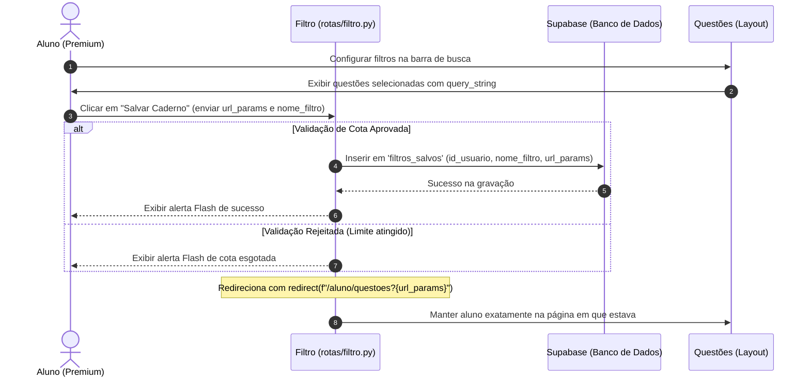

# Documentação Técnica: `rotas/filtro.py` (Filtros Personalizados)

## Descrição Geral
O módulo de Filtros permite que os estudantes salvem combinações complexas de parâmetros de busca de questões (matéria, assunto, banca, ano, cargo, escolaridade, etc.) sob uma denominação amigável personalizada. Isso cria cadernos virtuais dinâmicos salvos, agilizando frentes de estudo especializadas sem que o aluno precise reconfigurar todos os seletores a cada nova sessão.

---

## Integração de Fluxo e Interface (Sidebar)

Os filtros salvos atuam como cadernos persistentes e são injetados de forma assíncrona ou estrutural no layout principal da página de resoluções de questões (`resolver_questoes`).



Dessa forma, os cadernos aparecem na barra lateral e o aluno pode transitar entre diferentes disciplinas de concursos com um único clique na interface, sem perder o progresso ou precisar decorar os parâmetros da URL.

---

## Detalhamento das Rotas e APIs

### 1. Salvar Filtro (`/aluno/salvar_filtro`)
*   **Método**: `POST`
*   **Segurança e Decorators**:
    ```python
    @limiter.exempt
    @aluno_required
    ```
*   **Descrição**: Intercepta submissões contendo o `nome_filtro` e a `url_params` e persiste no banco Supabase vinculando ao ID do aluno logado.
*   **Resiliência**: Captura falhas temporárias de rede com o Supabase nos blocos `try/except`, registrando logs detalhados via biblioteca nativa `logging` (`logger.error`) para auditoria de suporte e garantindo que o aluno não caia em telas de erro brutas do Flask.

### 2. API de Exclusão (`/aluno/excluir_filtro/<filtro_id>`)
*   **Método**: `POST` (Retorna payload JSON)
*   **Segurança e Decorators**:
    ```python
    @limiter.exempt
    @aluno_required
    ```
*   **Blindagem Criptográfica contra IDOR (Controle de Acesso)**:
    A rota de deleção de cadernos salvos recebe o UUID do filtro na rota, mas blinda a instrução SQL exigindo de forma concomitante o identificador exclusivo do usuário logado:
    ```python
    supabase.table("filtros_salvos").delete().eq("id", filtro_id).eq("id_usuario", current_user.id)
    ```
    Dessa forma, caso um estudante de forma fraudulenta submeta um UUID de filtro pertencente a outro aluno da plataforma, o banco não localizará nenhuma linha correspondente para deletar, mantendo os dados da comunidade 100% protegidos.

---

## Padrões Globais de Segurança

### 1. Prevenção de Bloqueios Injustificados (`@limiter.exempt`)
Durante a organização intensa de cadernos de estudos, o aluno realiza múltiplos salvamentos, testes e exclusões sequenciais rápidas na interface de gestão. O uso do decorator `@limiter.exempt` é uma decisão estratégica de UX para contornar limites agressivos do firewall do `Flask-Limiter` que de outra forma causariam falsos-positivos bloqueando estudantes legítimos por tráfego incomum.

### 2. Mitigação contra CSRF (Cross-Site Request Forgery)
Todas as chamadas do módulo operam sob método `POST` e estão ativamente resguardadas pela extensão **SeaSurf** integrada globalmente no ecossistema do Flask. O formulário do frontend submete o token de sessão que é validado pela aplicação, blindando o módulo contra requisições maliciosas feitas de sites externos.

---

## Estrutura de Dados (Banco de Dados)

### Tabela: `filtros_salvos`
A persistência utiliza a estrutura minimalista otimizada a seguir no Supabase:

| Nome da Coluna | Tipo de Dado (SQL) | Descrição |
| :--- | :--- | :--- |
| **`id`** | `UUID` (Primary Key) | Identificador aleatório e único gerado na plataforma. |
| **`id_usuario`** | `UUID` (Foreign Key) | Chave estrangeira ligando ao perfil exclusivo do Aluno. |
| **`nome_filtro`** | `VARCHAR` | Nome amigável de exibição do caderno na sidebar (ex: "Polícia Federal - Direito Penal"). |
| **`url_params`** | `TEXT` | String crua de argumentos de busca URL persistidos para injeção subsequente. |
