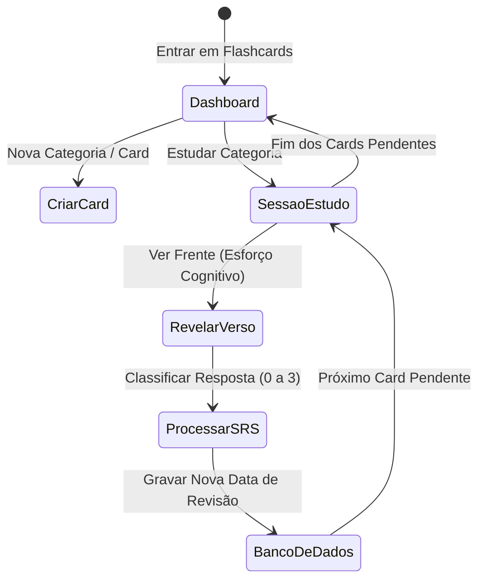

# Documentação Técnica: `rotas/flashcards.py` (Sistema SRS)

## Descrição Geral
O módulo de Flashcards implementa a consagrada metodologia de **Repetição Espaçada (SRS - Spaced Repetition System)**. Voltado exclusivamente para assinantes Premium, o sistema permite criar categorias temáticas e organizar cartões de estudo contendo "Frente e Verso". Um algoritmo matemático calcula de forma adaptativa a data ideal para a próxima revisão de cada cartão com base no nível de dificuldade reportado pelo aluno.

---

## O Algoritmo de Repetição Espaçada (SM-2 Customizado)

A plataforma adota uma variação robusta e calibrada do **Algoritmo SM-2 (SuperMemo-2)**. O cálculo do momento ideal para reexibir um cartão baseia-se em duas variáveis de estado armazenadas por flashcard:

1.  **Intervalo ($I$)**: O número de dias até que o card deva ser revisado novamente.
2.  **Facilidade ($EF$)**: Coeficiente de facilidade de memorização (E-Factor), que inicia em `2.5` e flutua entre um limite mínimo rígido de `1.3` e o máximo de `2.5`.

### Fórmulas de Transição de Estado

Quando o estudante avalia seu desempenho durante a sessão de estudos, ele fornece um feedback qualitativo classificado de `0` a `3`. O sistema recalcula as variáveis da seguinte forma:


#### Comportamento dos Intervalos por Nota:

*   **Nota `0` (Errei)**:
    *   O aprendizado é considerado rompido. O card retorna para a pilha imediata.
    *   $I_{novo} = 0$
    *   $EF_{novo} = \max(1.3, EF - 0.20)$
*   **Nota `1` (Difícil)**:
    *   O aluno lembra, mas com esforço considerável. O intervalo cresce sutilmente e a facilidade é reduzida.
    *   $I_{novo} = \max(1, \lfloor I \times 1.2 \rfloor)$
    *   $EF_{novo} = \max(1.3, EF - 0.15)$
*   **Nota `2` (Bom)**:
    *   O aluno lembra adequadamente. O intervalo cresce proporcionalmente à facilidade.
    *   Se $I = 0 \implies I_{novo} = 1$
    *   Se $I = 1 \implies I_{novo} = 4$
    *   Se $I > 1 \implies I_{novo} = \lfloor I \times EF \rfloor$
    *   $EF_{novo} = EF$ (mantido)
*   **Nota `3` (Fácil)**:
    *   O cartão foi respondido instantaneamente. O intervalo dá um salto agressivo para consolidar a memória de longo prazo e a facilidade recebe um bônus.
    *   Se $I \le 1 \implies I_{novo} = 7$
    *   Se $I > 1 \implies I_{novo} = \lfloor I \times EF \times 1.3 \rfloor$
    *   $EF_{novo} = \min(2.5, EF + 0.15)$

---

## Fluxo Operacional e de Sessão



---

## Detalhamento das Rotas e APIs

### 1. Dashboard Principal (`/aluno/flashcards`)
*   **Método**: `GET`
*   **Segurança**: `@aluno_required`, `@premium_required`
*   **Isenção de Rate Limits**: `@limiter.exempt` para garantir navegabilidade suave.
*   **Lógica**: Carrega todas as categorias ativas do usuário e realiza uma consulta com contagem otimizada exata (`count="exact"`) para determinar a quantidade de cards pendentes (`proxima_revisao <= agora`), exibindo o indicador dinâmico na tela.

### 2. Gerenciamento de Cards (`/aluno/flashcards/categoria/<id_categoria>`)
*   **Método**: `GET`
*   **Segurança**: `@aluno_required`, `@premium_required`
*   **Isenção de Rate Limits**: `@limiter.exempt`
*   **Lógica**: Exibe a lista completa de cartões de uma pasta. Possui validação estrita de ownership da categoria, redirecionando o aluno de volta ao painel principal em caso de URLs manipuladas ou dados inválidos.

### 3. Sessão de Revisão Ativa (`/aluno/flashcards/estudar/<id_categoria>`)
*   **Método**: `GET`
*   **Segurança**: `@aluno_required`, `@premium_required`
*   **Isenção de Rate Limits**: `@limiter.exempt`
*   **Lógica**: Carrega apenas os cartões cuja data de `proxima_revisao` seja menor ou igual ao horário atual (`lte`). Se o parâmetro for `'todos'`, faz uma mesclagem global de cards de todas as categorias do aluno, mantendo o isolamento por usuário.

### 4. APIs JSON de Persistência
*   `POST /api/flashcards/categoria/nova`: Insere uma categoria associada à string UUID do usuário logado.
*   `POST /api/flashcards/criar`: Adiciona cartões definindo a data da primeira revisão para o momento presente, fazendo com que fiquem imediatamente disponíveis para estudo.
*   `POST /api/flashcards/revisar`: Ponto focal da engine SRS. Executa o algoritmo matemático SM-2 customizado. Valida ownership do card (`eq("id_usuario", current_user.id)`) e atualiza o banco de dados.
*   `POST /api/flashcards/excluir/<id_card>`: Exclusão lógica individual sob prevenção rigorosa a IDOR.
*   `POST /api/flashcards/categoria/excluir/<id_categoria>`: Exclui a categoria física do banco de dados.

---

## Otimizações de Banco de Dados e Segurança

### Deleção Rápida em Cascata (`ON DELETE CASCADE`)
Para garantir integridade física total e eficiência de conexões, a tabela `flashcards` possui uma trava de chave estrangeira com comportamento de cascata em nível de banco de dados (Supabase/PostgreSQL) apontando para `flashcard_categorias`. 
Ao deletar uma categoria na API (`/api/flashcards/categoria/excluir/<id_categoria>`), o banco apaga instantaneamente de forma atômica todos os cartões vinculados, evitando varreduras custosas na aplicação Python e garantindo limpeza imediata do espaço de estudos.

### Isolamento Robusto Anti-IDOR
Nenhum ID inserido na URL pelo usuário é confiável. Por este motivo, todas as consultas e operações transacionais SQL exigem de forma mandatória a correspondência ao `current_user.id` do Flask-Login:

```python
# Exemplo de consulta blindada
supabase.table("flashcards").select("*").eq("id_flashcard", id_card).eq("id_usuario", current_user.id)
```

Isso garante imunidade contra requisições maliciosas destinadas a visualizar, alterar ou excluir cartões e categorias de outros estudantes da plataforma.

---

## Isenção de Rate Limit (`@limiter.exempt`)

> [!TIP]
> O uso do decorator `@limiter.exempt` nas rotas visuais de estudo e gerenciamento é uma decisão consciente de UX/Desempenho. 
> Durante sessões prolongadas de memorização ativa, o aluno realiza interações extremamente velozes passando dezenas ou centenas de cards. Sem essa isenção, o módulo `Flask-Limiter` interpretaria essas transições rápidas de páginas como um ataque de scraping ou força bruta, bloqueando o tráfego do usuário legítimo no meio de seus estudos.
