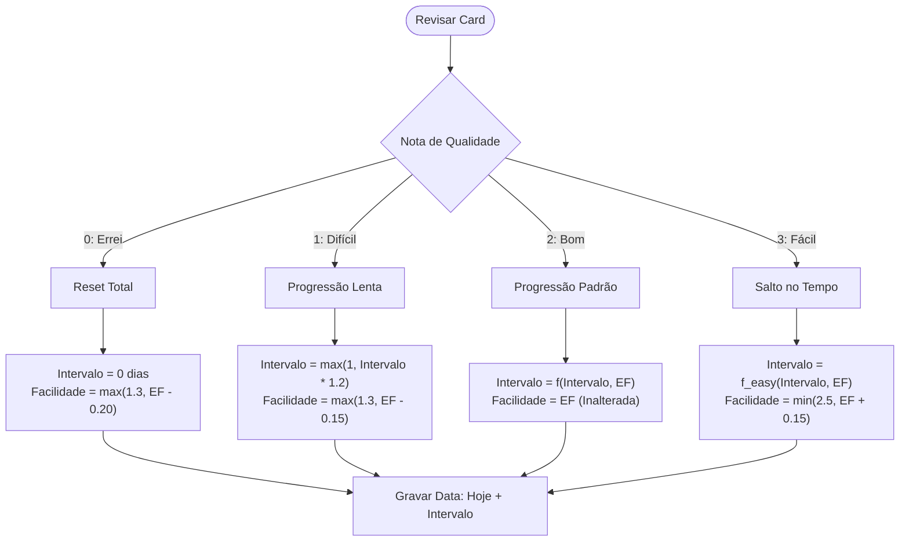
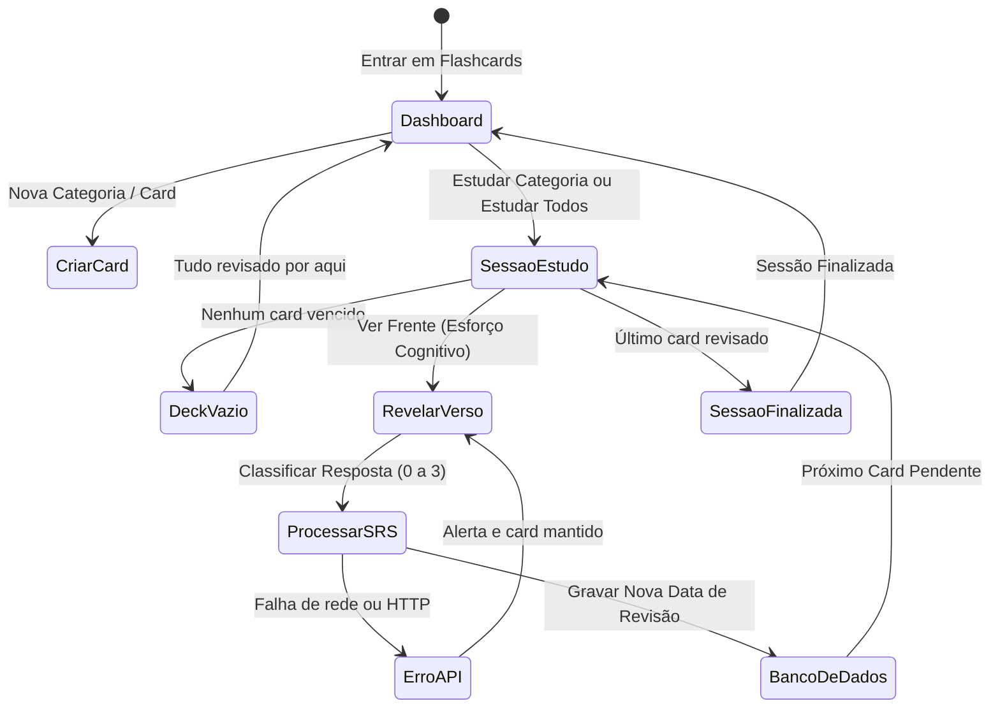

# Documentação Técnica: `rotas/flashcards.py` (Sistema SRS)

## Descrição Geral
O módulo de Flashcards implementa a consagrada metodologia de **Repetição Espaçada (SRS - Spaced Repetition System)**. Disponível para todo aluno autenticado (modelo software livre), o sistema permite criar categorias temáticas e organizar cartões de estudo contendo "Frente e Verso". Um algoritmo matemático calcula de forma adaptativa a data ideal para a próxima revisão de cada cartão com base no nível de dificuldade reportado pelo aluno.

A sessão de estudo pode ser aberta por categoria (`/aluno/flashcards/estudar/<id_categoria>`) ou de forma global (`/aluno/flashcards/estudar`). A interface trata explicitamente três situações: fila com cards pendentes, deck vazio e sessão concluída.

---

## O Algoritmo de Repetição Espaçada (SM-2 Customizado)

A plataforma adota uma variação robusta e calibrada do **Algoritmo SM-2 (SuperMemo-2)**. O cálculo do momento ideal para reexibir um cartão baseia-se em duas variáveis de estado armazenadas por flashcard:

1.  **Intervalo ($I$)**: O número de dias até que o card deva ser revisado novamente.
2.  **Facilidade ($EF$)**: Coeficiente de facilidade de memorização (E-Factor), que inicia em `2.5` e flutua entre um limite mínimo rígido de `1.3` e o máximo de `2.5`.

### Fórmulas de Transição de Estado

Quando o estudante avalia seu desempenho durante a sessão de estudos, ele fornece um feedback qualitativo classificado de `0` a `3`. O sistema recalcula as variáveis da seguinte forma:



#### Comportamento dos Intervalos por Nota:

*   **Nota `0` (Errei)**:
    *   O aprendizado é considerado rompido. O card retorna para a pilha imediata.
    *   $I_{novo} = 0$
    *   $EF_{novo} = \max(1.3, EF - 0.20)$
*   **Nota `1` (Difícil)**:
    *   O aluno lembra, mas com esforço considerável. O intervalo cresce sutilmente e a facilidade é reduzida.
    *   $I_{novo} = \max(1, \lfloor I \times 1.2 \rfloor)$
    *   $EF_{novo} = \max(1.3, EF - 0.15)$
*   **Nota `2` (Bom)**:
    *   O aluno lembra adequadamente. O intervalo cresce proporcionalmente à facilidade.
    *   Se $I = 0 \implies I_{novo} = 1$
    *   Se $I = 1 \implies I_{novo} = 4$
    *   Se $I > 1 \implies I_{novo} = \lfloor I \times EF \rfloor$
    *   $EF_{novo} = EF$ (mantido)
*   **Nota `3` (Fácil)**:
    *   O cartão foi respondido instantaneamente. O intervalo dá um salto agressivo para consolidar a memória de longo prazo e a facilidade recebe um bônus.
    *   Se $I \le 1 \implies I_{novo} = 7$
    *   Se $I > 1 \implies I_{novo} = \lfloor I \times EF \times 1.3 \rfloor$
    *   $EF_{novo} = \min(2.5, EF + 0.15)$

---

## Fluxo Operacional e de Sessão



> [!NOTE]
> A rota `/aluno/flashcards/estudar` (sem categoria) redireciona para `/aluno/flashcards/estudar/todos`. O botão **Estudar Todos** e links antigos continuam funcionando.

---

## Detalhamento das Rotas e APIs

### 1. Dashboard Principal (`/aluno/flashcards`)
*   **Método**: `GET`
*   **Segurança**: `@aluno_required`
*   **Isenção de Rate Limits**: `@limiter.exempt` para garantir navegabilidade suave.
*   **Lógica**: Carrega todas as categorias ativas do usuário e realiza uma consulta com contagem otimizada exata (`count="exact"`) para determinar a quantidade de cards pendentes (`proxima_revisao <= agora`), exibindo o indicador dinâmico na tela.

### 2. Gerenciamento de Cards (`/aluno/flashcards/categoria/<id_categoria>`)
*   **Método**: `GET`
*   **Segurança**: `@aluno_required`
*   **Isenção de Rate Limits**: `@limiter.exempt`
*   **Lógica**: Exibe a lista completa de cartões de uma pasta. Possui validação estrita de ownership da categoria, redirecionando o aluno de volta ao painel principal em caso de URLs manipuladas ou dados inválidos.

### 3. Sessão de Revisão Ativa (`/aluno/flashcards/estudar/<id_categoria>`)
*   **Método**: `GET`
*   **Segurança**: `@aluno_required`
*   **Isenção de Rate Limits**: `@limiter.exempt`
*   **Lógica**: Carrega apenas os cartões cuja data de `proxima_revisao` seja menor ou igual ao horário atual (`lte`). Se o parâmetro for `'todos'`, faz uma mesclagem global de cards de todas as categorias do aluno, mantendo o isolamento por usuário.

#### Atalho global (`/aluno/flashcards/estudar`)
*   **Método**: `GET`
*   **Comportamento**: redireciona com `302` para `/aluno/flashcards/estudar/todos`.
*   **Motivo**: preservar links antigos e permitir abrir a sessão global sem informar categoria.

#### Estados da sessão
*   **Fila com cards pendentes**: o progresso exibe `Card N de M`; a frente é mostrada primeiro e o verso é revelado ao clicar no card ou pressionar `Espaço`.
*   **Deck vazio**: o progresso exibe `0 cards` e a tela mostra **“Tudo revisado por aqui!”** com atalho para voltar ao painel. A frase “Aguardando...” não é mais usada.
*   **Sessão concluída**: após a última avaliação, a tela mostra **“Sessão Finalizada!”** e o progresso passa para `Concluído`.

#### Proteções da interface
*   **Duplo clique**: a função `revisar()` mantém a flag `revisando` e desabilita os quatro botões enquanto a requisição está em andamento; o card só avança após confirmação de sucesso da API.
*   **Falha de rede ou HTTP**: o erro é exibido com SweetAlert2 (ou `alert` como fallback), o card permanece na tela e os botões são reabilitados.
*   **Atalhos de teclado**: `Espaço` vira o card; `1`, `2`, `3` e `4` avaliam com qualidades `0`, `1`, `2` e `3`. Os atalhos são ignorados quando não há card ativo ou durante uma revisão.

### 4. APIs JSON de Persistência
*   `POST /api/flashcards/categoria/nova`: Insere uma categoria associada à string UUID do usuário logado.
*   `POST /api/flashcards/criar`: Adiciona cartões definindo a data da primeira revisão para o momento presente, fazendo com que fiquem imediatamente disponíveis para estudo.
*   `POST /api/flashcards/revisar`: Ponto focal da engine SRS. Executa o algoritmo matemático SM-2 customizado. A consulta usa `safe_execute()` + `maybe_single()`, valida ownership do card (`eq("id_usuario", current_user.id)`) e atualiza o banco de dados. Card inexistente ou de outro aluno retorna `404`; payload inválido ou qualidade fora da escala `0–3` retorna `400`.
*   `POST /api/flashcards/excluir/<id_card>`: Exclusão lógica individual sob prevenção rigorosa a IDOR.
*   `POST /api/flashcards/categoria/excluir/<id_categoria>`: Exclui a categoria física do banco de dados.

#### Contrato de resposta de `POST /api/flashcards/revisar`

| Status | Quando ocorre | Corpo |
|---|---|---|
| `200` | Revisão aplicada | `{"success": true, "novo_intervalo": <dias>}` |
| `400` | JSON inválido, `id_flashcard` ausente, `qualidade` não numérica ou fora de `0–3` | `{"success": false, "error": "..."}` |
| `404` | Card inexistente ou pertencente a outro aluno | `{"success": false, "error": "Flashcard não encontrado."}` |
| `500` | Falha interna ao consultar ou atualizar o banco | `{"success": false, "error": "Erro interno ao revisar flashcard."}` |

> [!NOTE]
> A criação de cards (`/api/flashcards/criar`) ainda não valida se `id_categoria` pertence ao aluno autenticado. Como todas as consultas de estudo e gerenciamento filtram por `id_usuario`, o card criado não vaza para o deck de outro aluno; a pendência é de integridade referencial e está registrada na seção de limitações.

---

## Interface, Tema e Responsividade

### Variáveis de tema
`static/css/flashcards.css` define `--primary-color-rgb` em `:root` (`61, 90, 128`, tema claro) e em `[data-bs-theme="dark"]` (`94, 106, 210`). A variável alimenta o gradiente do verso:

```css
background: linear-gradient(135deg, var(--card-bg) 0%, rgba(var(--primary-color-rgb), 0.05) 100%);
```

Sem essa variável o gradiente ficava inválido no tema escuro.

### Layout das faces
*   `.flashcard-inner` usa `display: grid`; `.card-front` e `.card-back` ocupam `grid-area: 1 / 1`.
*   A face mais alta define a altura do card, então respostas longas aumentam o card em vez de estourar sobre os controles.
*   `.flashcard-container` usa `width: 100%` com `max-width: 600px`, adaptando-se à coluna do Bootstrap em telas menores.
*   `.flashcard-content` usa `white-space: pre-wrap` e `overflow-wrap: anywhere` para preservar quebras de linha e evitar overflow horizontal.
*   Títulos dos estados vazio/final e da tela de gerenciamento usam `var(--texto-principal)`, funcionando nos temas claro e escuro.
*   O botão **Médio** não força `text-white`; o texto escuro padrão do `btn-warning` garante contraste no amarelo.

---

## Otimizações de Banco de Dados e Segurança

### Deleção Rápida em Cascata (`ON DELETE CASCADE`)
Para garantir integridade física total e eficiência de conexões, a tabela `flashcards` possui uma trava de chave estrangeira com comportamento de cascata em nível de banco de dados (Supabase/PostgreSQL) apontando para `flashcard_categorias`. 
Ao deletar uma categoria na API (`/api/flashcards/categoria/excluir/<id_categoria>`), o banco apaga instantaneamente de forma atômica todos os cartões vinculados, evitando varreduras custosas na aplicação Python e garantindo limpeza imediata do espaço de estudos.

### Isolamento Robusto Anti-IDOR
Nenhum ID inserido na URL pelo usuário é confiável. Por este motivo, todas as consultas e operações transacionais SQL exigem de forma mandatória a correspondência ao `current_user.id` do Flask-Login:

```python
# Exemplo de consulta blindada
supabase.table("flashcards").select("*").eq("id_flashcard", id_card).eq("id_usuario", current_user.id).maybe_single()
```

Na revisão, a consulta usa `safe_execute()` + `maybe_single()`: quando não há linha (card apagado, ID inválido ou card de outro aluno), a API responde `404` em vez de propagar um erro de “single JSON object”.

---

## Isenção de Rate Limit (`@limiter.exempt`)

> [!TIP]
> O uso do decorator `@limiter.exempt` nas rotas visuais de estudo e gerenciamento (incluindo o atalho `/aluno/flashcards/estudar`) é uma decisão consciente de UX/Desempenho.
> Durante sessões prolongadas de memorização ativa, o aluno realiza interações extremamente velozes passando dezenas ou centenas de cards. Sem essa isenção, o módulo `Flask-Limiter` interpretaria essas transições rápidas de páginas como um ataque de scraping ou força bruta, bloqueando o tráfego do usuário legítimo no meio de seus estudos.

---

## Limitações Conhecidas

*   **Ownership na criação**: `POST /api/flashcards/criar` ainda não confirma se `id_categoria` pertence ao aluno. As consultas de leitura e estudo sempre filtram por `id_usuario`, então não há vazamento entre decks, mas pode haver card órfão ou vinculado a uma categoria de outro aluno.
*   **Ordenação da sessão**: os cards vencidos são retornados na ordem do banco; não há `ORDER BY proxima_revisao`. A sessão funciona, mas não prioriza explicitamente os cards mais atrasados.
*   **Teto de facilidade**: o E-Factor é limitado a `2.5`. A nota **Fácil** aumenta o intervalo, mas não eleva a facilidade acima do valor inicial.
*   **Conteúdo dos cards**: a renderização usa `innerHTML` depois de converter `**texto**` em `<b>`. O recurso depende da CSP e pressupõe que o conteúdo criado pelo aluno ou gerado pela IA seja confiável.

---

## Validação e Testes

A cobertura específica está em `tests/test_flashcards.py` e inclui:

*   dashboard, gerenciamento e carregamento de cards;
*   alias `/aluno/flashcards/estudar` → `/aluno/flashcards/estudar/todos`;
*   estado vazio sem a frase “Aguardando...”;
*   algoritmo SM-2 customizado para as qualidades `0`, `1`, `2` e `3`;
*   revisão de card inexistente (`404`) e qualidade inválida (`400`);
*   criação e exclusão de cards e categorias.

```powershell
venv\Scripts\python.exe -m pytest tests/test_flashcards.py -q
```

No estado atual, a suíte específica passa com **19 testes**.
