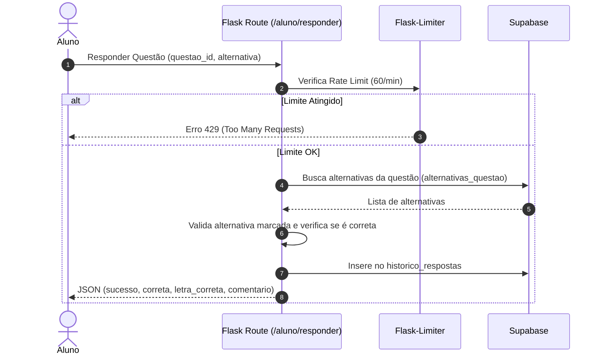
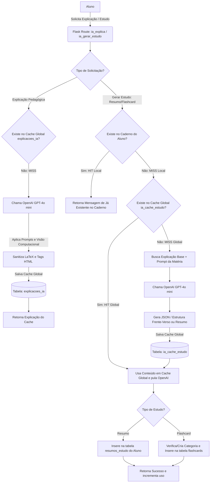

# 📚 Módulo de Questões e Inteligência Artificial (`rotas/questao.py`)

Este módulo constitui o núcleo operacional e pedagógico do **Gabaritei**, processando desde a lógica transacional de resolução de questões e controle de ofensivas diárias até o ecossistema generativo da **Gabi IA** (explicações e materiais permanentes de estudo com barramento de cache duplo).

---

## 🛠️ Arquitetura e Funcionalidades Principais

### 1. Resolução e Motor de Ofensiva (Streak)
*   **`responder_questao`**: Rota transacional principal (`/aluno/responder`). Recebe a alternativa marcada, valida contra o banco de dados e registra a atividade no histórico do aluno.
*   **Motor da Ofensiva**: Atualiza de forma resiliente as ofensivas diárias do aluno considerando o fuso horário oficial de Brasília (UTC-3). A lógica matemática da progressão do streak é expressa por:

$$\text{Streak}_{\text{hoje}} = \begin{cases} \text{Streak}_{\text{ontem}} + 1 & \text{se } \text{data}_{\text{última}} = \text{hoje} - 1 \\ 1 & \text{se } \text{data}_{\text{última}} < \text{hoje} - 1 \\ \text{Streak}_{\text{ontem}} & \text{se } \text{data}_{\text{última}} = \text{hoje} \end{cases}$$

*   **`salvar_resposta`**: Endpoint de API (`/api/responder`) para persistência síncrona das respostas do aluno no histórico.

### 2. Página Pública de Questão (Vitrine SEO)
*   **`visualizar_questao_seo`**: Exibe a página individual da questão (`/questoes/<materia>/q<id>`). Implementa **Redirecionamento Canônico (301)** para corrigir dinamicamente quaisquer slugs corrompidos digitados na URL, garantindo perfeita indexação no Google. É uma vitrine pública: visitantes leem a questão e as alternativas, mas só usuários autenticados respondem — o card substitui o botão de resposta por "Cadastre-se para responder".

### 3. Listagem e Filtros de Questões (`/aluno/questoes`)

*   **`resolver_questoes`**: página principal de resolução, também servida por `/questoes/<materia_slug>` e `/questoes/<materia_slug>/<topico_slug>`. A listagem é pública; quando há sessão, o histórico do aluno alimenta os filtros de status.
*   **Filtro de status**: `f_status = request.args.get('status', 'todas')` — o padrão é **`todas`** (antes era `nao_respondidas`). A sidebar (`templates/components/sidebar_filtros.html`) marca "🔎 Todas as Questões" como selecionada quando o parâmetro está ausente, e "🆕 Apenas Não Respondidas" só fica ativa com `?status=nao_respondidas` explícito.
*   **Valores aceitos**: `todas` (sem filtro), `nao_respondidas` (`NOT IN` nos ids já respondidos), `respondidas`, `acertos` e `erros`. Sem histórico, as três últimas consultas usam `id_questao = 0` para retornar lista vazia em vez de vazar o banco inteiro.
*   **Paginação e ordenação**: 10 questões por página, ordenadas por `ordem_aleatoria`, com contagem exata (`CountMethod.exact`) para calcular `tem_proxima`/`tem_anterior`.
*   **Filtros combinados**: matéria, tópico, subtópico, banca, órgão, ano, nível, cargo e tipo são aplicados via `.in_`/`.eq` sobre a view `view_questoes_completa`, sempre restrita a `status='publicada'`.

### 4. Ecossistema Pedagógico de IA (Gabi IA)
*   **`ia_explica`**: Gera explicações hiper-pedagógicas em tempo real (`/api/ia_explica`) para usuários autenticados. Integra prompts de sistema altamente restritivos para evitar alucinações de lei e suporta **visão computacional** enviando imagens extraídas do enunciado/alternativas via URLs assinadas e seguras à API do GPT-4o mini.
*   **`ia_gerar_estudo`**: Endpoint unificado (`/api/ia/gerar_estudo`) que extrai a teoria subjacente à questão para gerar resumos ou flashcards permanentes:
    *   **Resumos**: Gravados no caderno de resumos do aluno (`resumos_estudo`).
    *   **Flashcards**: Pergunta e resposta estruturadas para memorização ativa (Frente/Verso), salvas automaticamente no respectivo baralho da matéria (`flashcards` e `flashcard_categorias`).

---

## 📊 Fluxos Operacionais (Diagramas Mermaid)

### Diagrama 1: Ciclo de Resolução e Motor de Ofensiva (Streak)
O diagrama abaixo detalha o fluxo de validação de resposta do aluno, a persistência no histórico de estudos e a execução da lógica de streak no fuso horário UTC-3:

### Diagrama 2: Arquitetura de IA (Gabi IA) com Barramento de Cache Duplo
Ilustração do ecossistema inteligente que impede redundâncias, implementando cache local no caderno/baralho do aluno e cache global persistido para otimizar custos com APIs e tempo de latência:

---

## ⚖️ Diretrizes e Regras do Motor Generativo (GPT-4o mini)

O motor generativo adota uma política de **tolerância zero contra alucinações**, além de aplicar formatações rígidas no envio de outputs ao frontend:

### 1. Regras Antialucinação Legislativa
*   **Fundamentação Real**: É expressamente proibido deduzir ou inventar leis, decretos, portarias ou súmulas jurídicas. Se não houver certeza doutrinária ou legal, o motor silencia a dedução.
*   **Precisão Territorial**: O motor respeita de forma rígida a abrangência territorial da lei seca (e.g. diferenciando uma lei municipal ou estadual de normas nacionais como a Lei nº 8.112/1990).
*   **Alerta de Desatualização**: Caso o enunciado trate de matéria revogada, o sistema gera obrigatoriamente um bloco de alerta técnico:

> [!WARNING]
> ### ⚖️ Alerta de Desatualização Legislativa
> [Explicação sucinta sobre a nova norma ou alteração na jurisprudência.]

### 2. Normas Estritas de Formatação (LaTeX e HTML)
*   **Destaque Visual**: É proibido o uso de asteriscos para negrito (`**`). Todos os termos técnicos devem ser enfatizados utilizando as tags HTML `<b>` e `</b>` (e.g. `<b>Princípio da Legalidade</b>`).
*   **Renderização KaTeX/LaTeX**: 
    *   *Explicações*: Uso obrigatório de $ ... $ para delimitadores matemáticos no corpo de texto (inline) e $$ ... $$ para fórmulas em bloco separado.
    *   *Resumos/Flashcards*: Uso obrigatório de delimitadores curtos `\( ... \)` para inline e `\[ ... \]` para destaque em bloco.
    *   *Fórmulas*: Toda notação fracionária ou complexa deve ser expressa por equações formais em LaTeX (e.g. `\( \frac{a}{b} \)`), garantindo renderização limpa no frontend.
*   **Prevenção Anti-Layout**:
    *   Remoção automática por Expressão Regular no back-end de quaisquer caracteres de citação (`>` ou `|`) no início das linhas, impedindo a injeção indesejada de barras de blockquotes que quebram o design responsivo.
    *   Tratamento estrito de underscores (`_`) em variáveis ou atributos (e.g. `Nome_RazaoSocial`), envolvendo-os sempre em blocos de código (\`...\`) ou tags de texto LaTeX (`\text{...}`) para não corromper o interpretador de Markdown.

---

## 🔐 Segurança, IDOR e Integridade de Dados

*   **Proteção Contra IDOR**:
    *   A deleção física de questões (`excluir_questao`) migrou para o ambiente administrativo (`rotas/admin_api.py`, blindada por `@admin_required` com trava de dispositivo único — ver `docs/rotas/admin.md` no repositório do painel administrativo). O blueprint de questões do aluno não expõe nenhuma rota destrutiva.
    *   A inserção de resumos e flashcards sempre resolve e força a propriedade ao UUID autenticado do aluno (`current_user.id`), inviabilizando qualquer injeção ou tentativa de alteração cruzada de dados por IDs arbitrários.
*   **Moderação sem IA (blocklist + denúncia humana)**: o salvamento de novos comentários passa pela blocklist local (`verificar_texto_improprio`) — a antiga moderação por API de IA foi removida. A segunda barreira é a **denúncia** (`POST /api/comentarios/<id_comentario>/reportar`, botão 🚩 em cada comentário): grava em `reports_comentarios` (no máximo 1 por comentário/aluno → `409` duplicado amigável; uuid validado; comentário inexistente → `404`) e a triagem é **humana**, no painel do admin (repo separado).
*   **IA com BYOK**: `/api/ia_explica` e `/api/ia/gerar_estudo` chamam a camada `provedores_ia.chamar_ia()` com a **própria chave do aluno** (OpenAI, Google Gemini ou Anthropic), guardada apenas localmente (SQLite + DPAPI). Os prompts e parâmetros calibrados permanecem idênticos; os caches (`explicacoes_ia`, `ia_cache_estudo`) e a gravação no banco seguem inalterados. Detalhes em [docs/ia.md](../ia.md).

---
> [!NOTE]
> **Tabelas de Cache Operacionais**:
> *   `explicacoes_ia`: Armazena explicações brutas associadas a cada ID de questão.
> *   `ia_cache_estudo`: Centraliza em JSON os resumos e flashcards categorizados gerados por IA, eliminando requisições repetidas de OpenAI para a mesma questão acadêmica no ecossistema global.
