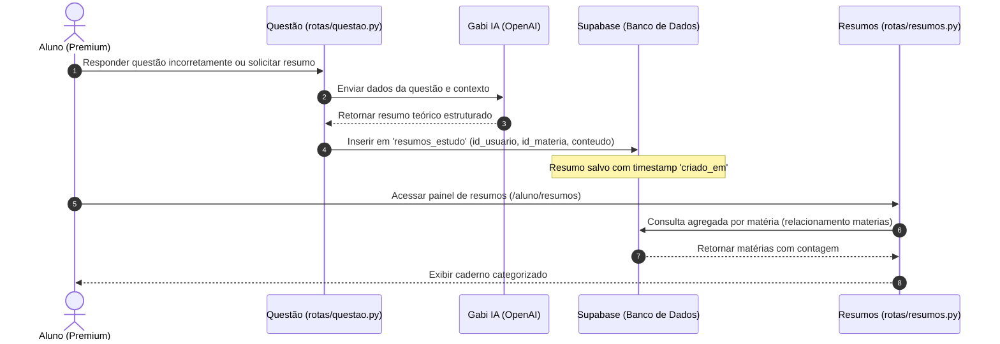

# Documentação Técnica: `rotas/resumos.py` (Resumos Teóricos)

## Descrição Geral
O módulo de Resumos gerencia o acesso e a organização dos resumos teóricos gerados por inteligência artificial (Gabi IA) a partir de questões resolvidas pelo usuário. Ele atua como um caderno de estudos digital, onde todo o conhecimento extraído é categorizado por matéria de forma organizada para facilitar a revisão posterior do aluno.

---

## Fluxo de Processamento de Resumos

O ciclo de vida de um resumo teórico abrange a geração dinâmica (integrada ao módulo de questões) até a catalogação no painel de revisões do aluno premium:



---

## Detalhamento das Rotas e APIs

### 1. Painel de Resumos (`/aluno/resumos`)

*   **Método**: `GET`
*   **Segurança e Decorators**:
    ```python
    @login_required
    @aluno_required
    ```
*   **Descrição**: Fornece uma visão consolidada do caderno de estudos do aluno, exibindo cada disciplina juntamente com a contagem de resumos gerados.
*   **Lógica de Agregação de Alta Performance**:
    Para evitar gargalos de consultas recursivas e múltiplas viagens de rede (N+1 queries), a busca é realizada utilizando o recurso de junção (*join*) nativo do PostgREST do Supabase:
    ```python
    query = supabase.table('resumos_estudo').select('id_materia, materias(nome_materia)').eq('id_usuario', str(current_user.id))
    ```
    Isso retorna em uma única requisição a lista de ID de matéria juntamente com os respectivos nomes. O agrupamento e a contagem de resumos ocorrem inteiramente em memória na aplicação Flask através de um dicionário hash (`materias_dict`), otimizando o consumo de CPU do banco de dados.

---

### 2. Caderno de Estudos por Matéria (`/aluno/resumos/materia/<int:id_materia>`)

*   **Método**: `GET`
*   **Segurança e Decorators**:
    ```python
    @login_required
    @aluno_required
    ```
*   **Descrição**: Lista de forma detalhada e cronológica todos os resumos de uma matéria específica.
*   **Garantia de Integridade Relacional (Fail-Fast)**:
    Antes de buscar os resumos, o sistema verifica a real existência da matéria no banco para evitar que IDs inexistentes passem em branco ou gerem layouts vazios indesejados. Em caso de ausência, dispara imediatamente um código HTTP 404:
    ```python
    m_query = supabase.table('materias').select('nome_materia').eq('id_materia', id_materia).single()
    m_res = safe_execute(m_query)
    if not m_res or not m_res.data:
        abort(404)
    ```
*   **Numeração Cronológica de Estudos**:
    Para manter a consistência metodológica do aprendizado, os dados são retornados do Supabase sob ordenação cronológica ascendente estrita:
    ```python
    .order('criado_em', desc=False)
    ```
    Dessa forma, o loop do template Jinja2 renderiza os resumos numerando-os consecutivamente (`Resumo #1`, `Resumo #2`, etc.) via `loop.index`, respeitando perfeitamente a linha do tempo do aprendizado do aluno.

---

### 3. Exclusão Física de Resumos (`/api/resumos/excluir/<id_resumo>`)

*   **Método**: `POST` (API JSON)
*   **Segurança e Decorators**:
    ```python
    @login_required
    @aluno_required
    ```
*   **Proteção Rígida Contra IDOR (Insecure Direct Object References)**:
    A rota de exclusão possui blindagem de segurança no nível de consulta. Mesmo que um atacante saiba o UUID de um resumo que não lhe pertença e tente forçar a chamada da API, a cláusula SQL exige cumulativamente o ID do usuário logado:
    ```python
    query = supabase.table('resumos_estudo').delete().eq('id_resumo', id_resumo).eq('id_usuario', str(current_user.id))
    ```
    Se o resumo pertencer a outro usuário, a query simplesmente não afetará nenhuma linha (`row_count = 0`), garantindo privacidade absoluta dos dados.

---

## Regras de Negócio e Segurança

| Regra de Negócio | Descrição | Implementação Técnica |
| :--- | :--- | :--- |
| **Privacidade Estrita** | Um aluno não pode ver nem deletar resumos de outros | Filtragem obrigatória por `current_user.id` em todas as queries |
| **Resiliência de Comunicação** | Tolerância a falhas temporárias de rede com o Supabase | Encapsulamento de requisições através do método centralizado `safe_execute` |

> [!WARNING]
> A rota de deleção utiliza requisição `POST` para fins de compatibilidade simples com chamadas assíncronas do frontend (`fetch`/`axios`), e o identificador `<id_resumo>` deve ser um UUID válido de 36 caracteres gerado originalmente pela plataforma.
