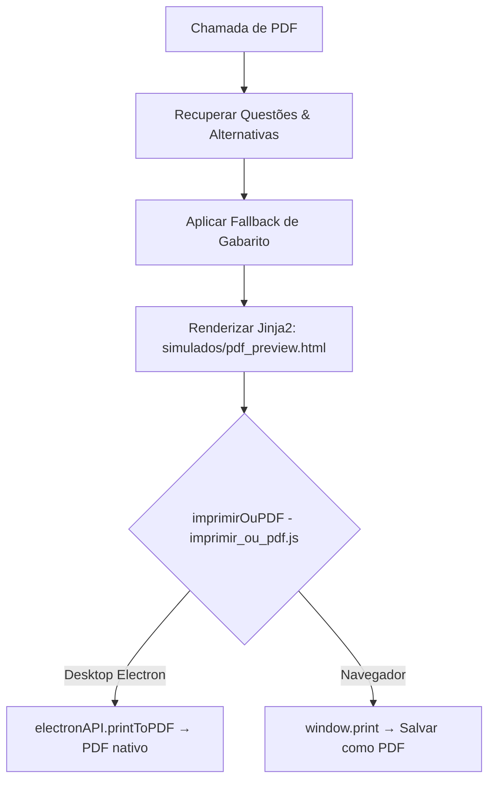

# Documentação Técnica: `rotas/simulado.py` (Provas Simuladas)

## Descrição Geral
O módulo de Simulados implementa o ecossistema de exames cronometrados personalizados do Gabaritei Questões. Disponível para todo aluno autenticado (modelo software livre), ele permite criar e realizar simulados públicos ou privados gerados dinamicamente com base em múltiplos filtros taxonômicos e organizacionais, participar de classificações em tempo real e exportar cadernos de prova profissionais no formato PDF.

---

## Ciclo de Vida do Simulado (Geração Dinâmica e Rollback)

O fluxo de processamento de um simulado compreende a criação do cabeçalho físico, a varredura dinâmica e o sorteio de questões no banco e, caso os critérios sejam restritivos a ponto de não retornarem questões suficientes, a limpeza física dos registros órfãos:

```mermaid
sequenceDiagram
    autonumber
    actor Aluno
    participant S as Simulado (rotas/simulado.py)
    participant DB as Supabase (Banco de Dados)

    Aluno->>S: Definir título, privacidade e filtros avançados
    S->>DB: Inserir cabeçalho em 'simulados'
    DB-->>S: Retornar 'id_simulado'
    
    rect rgb(25, 25, 35)
        note over S: Varredura de Filtros por Matéria e Tópicos
        S->>DB: Consultar view_questoes_completa (limit 500)
        DB-->>S: Retornar pool de questões candidatas
        
        alt Pool de Questões >= Quantidade Solicitada
            note over S: Executa sorteio random.sample(pool, qtd)
            S->>DB: Salvar em 'simulados_questoes' (lote associativo)
            S-->>Aluno: Confirmar geração com sucesso!
        else Pool de Questões < Quantidade Solicitada e > 0
            note over S: Sorteia todas as candidatas do Pool
            S->>DB: Salvar em 'simulados_questoes' (lote associativo)
            S-->>Aluno: Confirmar geração com sucesso parcial!
        else Pool de Questões = 0 (Vazio)
            note over S: Mecanismo de Auto-Rollback Transacional
            S->>DB: Deletar cabeçalho em 'simulados' (id_simulado)
            S-->>Aluno: Exibir alerta: Questões insuficientes.
        end
    end
```



---

## Motor de Sorteio e Filtros Avançados

O sorteio baseia-se na visão SQL materializada `view_questoes_completa`, que consolida em uma única tabela todos os metadados de escolaridade, bancas, órgãos, cargos, tópicos e anos.
O algoritmo Python executa as requisições em lote para cada par de Matéria/Tópico parametrizado, coletando um subconjunto de até 500 candidatos e reduzindo a massa por meio da função estocástica de alta performance do Python:

```python
if len(pool_questoes) > qtd:
    sorteadas = random.sample(pool_questoes, qtd)
else:
    sorteadas = pool_questoes
```

---

## Detalhamento das Rotas e APIs

### 1. Painel de Controle (`/aluno/simulados`)
*   **Método**: `GET`
*   **Segurança**: `@aluno_required`
*   **Isenção de Rate Limits**: `@limiter.exempt`
*   **Descrição**: Exibe a interface central de provas. Realiza duas varreduras paralelas no banco de dados Supabase:
    1.  **Simulados Públicos**: Aberto para todos os alunos autenticados, carregando o autor através de junção com a tabela de usuários (`usuarios(username)`).
    2.  **Simulados Privados**: Filtrados estritamente pelo ID do estudante logado.
    Também carrega listas taxonômicas (bancas, órgãos, matérias e cargos) para municiar o modal dinâmico de filtros.

### 2. Geração Dinâmica (`/aluno/simulados/gerar`)
*   **Método**: `POST`
*   **Segurança**: `@aluno_required`
*   **Isenção de Rate Limits**: `@limiter.exempt`
*   **Lógica**: Processa formulários com múltiplos vetores de restrição. Em caso de falhas sistêmicas ou problemas de rede com o banco durante as inserções em lote, captura a exceção em um bloco `try/except` que dispara uma rotina física de rollback apagando imediatamente a "capa" criada na tabela `simulados` para impedir registros órfãos ou inconsistentes na plataforma.

### 3. Interface de Execução (`/aluno/simulados/fazer/<id_simulado>`)
*   **Método**: `GET`
*   **Segurança**: `@aluno_required`
*   **Isenção de Rate Limits**: `@limiter.exempt`
*   **Blindagem de Privacidade**:
    Antes de carregar a prova, o sistema avalia a flag `eh_privado` do simulado. Se for privada e o criador for diferente de `current_user.id`, bloqueia o acesso instantaneamente com mensagem de erro amigável e redirecionamento de segurança.
*   **Uniformidade Psicológica (Anti-Memorização)**:
    Para assegurar a eficácia dos testes, as questões recuperadas do banco são baralhadas aleatoriamente em memória antes de serem entregues ao frontend através da função:
    ```python
    random.shuffle(questoes)
    ```
    Isso impede que o aluno aprenda a ordem sequencial das questões ou decore as respostas baseando-se no posicionamento visual das folhas de prova. As alternativas dentro de cada questão permanecem organizadas lexicograficamente pela letra (`A`, `B`, `C`...) para coerência textual do exame.

### 4. Correção Automática e Ranking (`/aluno/simulados/corrigir/<id_simulado>`)
*   **Método**: `POST`
*   **Lógica**:
    *   Busca as alternativas marcadas como corretas (`is_correct = True`) para os IDs das questões que integram o simulado.
    *   Compara item a item com as submissões via formulário do aluno (`resp_{q_id}`).
    *   Calcula a nota em escala de `0` a `10` e grava na tabela `simulados_resultados`.
    *   Se o simulado for de acesso público, busca em tempo real o **Top 10 Global** de notas para exibição no template de encerramento.

### 5. API de Exclusão (`/aluno/simulados/excluir/<id_simulado>`)
*   **Método**: `POST`
*   **Proteção Contra IDOR**:
    Garante que apenas o criador original possa realizar a deleção. Valida a ownership antes da transação física no banco:
    ```python
    res = safe_execute(supabase.table('simulados').select('id_criador').eq('id', id_simulado).single())
    if res.data and res.data.get('id_criador') == current_user.id:
        safe_execute(supabase.table('simulados').delete().eq('id', id_simulado))
    ```

---

## Exportação PDF — Prévia Navegável Unificada (padrão dos resumos)

A rota `/simulado/<id_simulado>/pdf` entrega **sempre** a prévia navegável da prova (`simulados/pdf_preview.html`) com o botão **"Imprimir / Salvar PDF"** — a mesma experiência implementada nos resumos. O fluxo é client-side, sem renderização de PDF no servidor:



*   **Desktop (Electron)**: o Chromium do Electron não renderiza `application/pdf` inline; `imprimir_ou_pdf.js` detecta o `electronAPI` e gera o PDF nativo (A4), aberto no leitor padrão do sistema.
*   **Navegador**: `window.print()` abre o preview de impressão nativo — o `@media print` da página esconde a barra de ações e expande a folha A4; o aluno usa **"Salvar como PDF"**.
*   O corpo da prova (`_pdf_corpo.html`) e a folha de estilos (`pdf_style.css`) são compartilhados: a folha renderizada na tela é a mesma que sai na impressão. (O antigo pipeline WeasyPrint — template `pdf.html` e URIs `file:///` — foi removido do fluxo; o `build.ps1` ainda baixa um runtime GTK legado, mas o backend não o usa.)

### Algoritmo Específico de Fallback do Gabarito
Para garantir que o caderno impresso traga as respostas corretas de cada questão de forma impecável no final do documento (gabarito automático), foi projetada uma varredura hierárquica em dois níveis:
```python
# 1º Nível: Procura metadados gravados na própria estrutura simplificada da questão
letra_certa = q.get('gabarito') or q.get('alternativa_correta') or q.get('resposta') or q.get('resposta_correta')

# 2º Nível: Se nulo, varre as alternativas associadas em busca de sinalizadores booleanos do Supabase
if not letra_certa:
    for a in q['alternativas_questao']:
        if a.get('is_correta') or a.get('correta') or a.get('certa') or a.get('gabarito'):
            letra_certa = a.get('letra')
            break

q['letra_gabarito'] = letra_certa if letra_certa else 'N/A'
```

---

## Segurança de Transações de Banco de Dados

| Operação | Mecanismo de Integridade | Comportamento Técnico |
| :--- | :--- | :--- |
| **Exclusão de Simulado** | `ON DELETE CASCADE` | Ao deletar o cabeçalho físico, as chaves estrangeiras apagam automaticamente todos os registros associativos nas tabelas `simulados_questoes` e `simulados_resultados` em nível de banco de dados (Supabase/PostgreSQL) de forma atômica. |
| **Acesso Autenticado** | Decorator de Nível de Blueprint | Exige autenticação de aluno (`@aluno_required`) em todas as rotas de simulado — no modelo software livre, todo aluno autenticado tem acesso completo. |
| **Blindagem de Ownership** | Prevenção a IDOR | Verificação compulsória de `current_user.id` em todas as rotas mutativas ou de simulados privados. |

> [!WARNING]
> Falhas no carregamento da prévia (rede/Supabase) são capturadas no bloco `try/except` da rota, exibindo mensagens flash amigáveis na tela e registrando no terminal com a marcação `❌ Erro ao carregar o PDF do simulado: {e}`.
